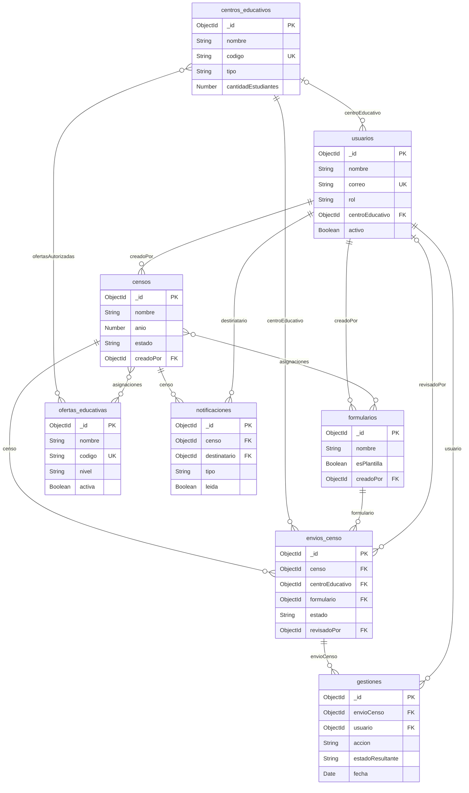

# SICEN – Diseño de la base de datos

Bitácora 3 · SOFT-11 Proyecto Integrador 1 · Responsable 2: Diseño de base de datos

## 1. Resumen del diseño

La base de datos de SICEN tiene **8 colecciones** en MongoDB Atlas, definidas con Mongoose en el backend de NestJS. Este documento describe el modelo implementado en src/\<módulo\>/schemas/ del repositorio (rama main).

| Colección          | Propósito                                                                                                                  |
|--------------------|----------------------------------------------------------------------------------------------------------------------------|
| usuarios           | Jefatura, técnicos de la DAE y directores de centro que usan el sistema (RF-06).                                           |
| formularios        | Formularios censales y plantillas, con preguntas, apariencia, instructivo y flujo de aprobación embebidos (RF-01 a RF-05). |
| ofertas-educativas | Catálogo de ofertas educativas (preescolar, primaria, secundaria, educación especial).                                     |
| centros-educativos | Centros que responden al censo, con su dirección, teléfonos y ofertas autorizadas.                                         |
| censos             | Procesos censales: estado, fechas y asignaciones de formulario por oferta educativa.                                       |
| envios-censo       | Respuestas de un centro a un formulario dentro de un censo, con su estado de revisión.                                     |
| gestiones          | Bitácora de auditoría: cada acción sobre un envío queda registrada.                                                        |
| notificaciones     | Alertas y avisos dirigidos a un usuario, asociados a un censo.                                                             |

**Decisiones de diseño**

- **Embebido** lo que siempre se lee junto con su documento: preguntas, apariencia, instructivo y flujo de aprobación en formularios; asignaciones y mensajes en censos; respuestas en envios-censo; dirección y teléfonos en centros-educativos.

- **Referencia** (ObjectId) para lo que se consulta por separado o crece sin límite: usuarios, centros, censos, envíos, gestiones y notificaciones.

- **Arreglos con límites** definidos en el esquema: preguntas de 10 a 100, asignaciones de 1 a 10, teléfonos de 1 a 3, ofertas autorizadas de 1 a 8 y hasta 100 respuestas por envío.

- **Marcas de tiempo:** usuarios, censos, envios-censo, centros-educativos y ofertas-educativas usan timestamps: true (createdAt y updatedAt). formularios, gestiones y notificaciones usan un campo de fecha inmutable.

## 2. Diagrama de colecciones

Un envío une un censo, un centro y un formulario, y cada acción sobre él queda registrada en gestiones. Las líneas indican referencias entre colecciones (FK = referencia ObjectId, PK = clave primaria, UK = único). En el diagrama los guiones de los nombres se escriben como guion bajo (`envios_censo` corresponde a `envios-censo`).

Los siguientes datos no aparecen como entidades porque están **embebidos** dentro de su documento: `preguntas`, `apariencia`, `instructivo` y `flujoAprobacion` en formularios; `asignaciones` y `mensajes` en censos; `respuestas` en envios-censo; `direccion` y `telefonos` en centros-educativos; `ambito` en usuarios.

## 3. Descripción de las colecciones

En las tablas, “Obligatorio” y “Único” reflejan el esquema de Mongoose; las reglas marcadas con (DTO) se validan además en la API con class-validator.

### 3.1 Colección usuarios

| Campo                | Tipo de dato                       | Obligatorio                  | Único | Reglas de validación                                                                                        |
|----------------------|------------------------------------|------------------------------|-------|-------------------------------------------------------------------------------------------------------------|
| \_id                 | ObjectId                           | Sí (auto)                    | Sí    | Generado por MongoDB.                                                                                       |
| nombre               | String                             | Sí                           | No    | No vacío; se aplica trim.                                                                                   |
| correo               | String                             | Sí                           | Sí    | Formato de correo válido (DTO); se guarda en minúsculas y con trim.                                         |
| contrasenna          | String                             | Sí                           | No    | Mínimo 8 caracteres al crear (DTO); se guarda cifrada y nunca se devuelve en las consultas (select: false). |
| rol                  | String (enum)                      | Sí                           | No    | JefaturaDAE, TecnicoDAE o Director.                                                                         |
| permisos             | Array de String                    | No                           | No    | Por defecto \[\].                                                                                           |
| ambito               | Subdocumento                       | No                           | No    | Ver tabla 3.1.1.                                                                                            |
| centroEducativo      | ObjectId (ref. centros-educativos) | Solo si rol = Director (DTO) | No    | \_id válido.                                                                                                |
| activo               | Boolean                            | Sí                           | No    | Por defecto true. Los usuarios se desactivan, no se eliminan.                                               |
| createdAt, updatedAt | Date                               | Sí (auto)                    | No    | Generados por timestamps.                                                                                   |

**3.1.1 Subdocumento ambito** (sin \_id)

| Campo  | Tipo de dato | Obligatorio | Único | Reglas de validación |
|--------|--------------|-------------|-------|----------------------|
| tipo   | String       | No          | No    | Con trim.            |
| nombre | String       | No          | No    | Con trim.            |

### 3.2 Colección formularios

| Campo           | Tipo de dato             | Obligatorio | Único | Reglas de validación                                                                               |
|-----------------|--------------------------|-------------|-------|----------------------------------------------------------------------------------------------------|
| \_id            | ObjectId                 | Sí (auto)   | Sí    | Generado por MongoDB.                                                                              |
| nombre          | String                   | Sí          | No    | No vacío; se aplica trim.                                                                          |
| descripcion     | String                   | No          | No    | Con trim.                                                                                          |
| esPlantilla     | Boolean                  | Sí          | No    | Por defecto false.                                                                                 |
| apariencia      | Subdocumento             | No          | No    | Ver tabla 3.2.1.                                                                                   |
| instructivo     | Subdocumento             | No          | No    | Ver tabla 3.2.2.                                                                                   |
| flujoAprobacion | Array de String          | No          | No    | Por defecto \[\]. Cada elemento es un paso del flujo, por ejemplo \['TecnicoDAE', 'JefaturaDAE'\]. |
| preguntas       | Array de subdocumentos   | Sí          | No    | De 10 a 100 elementos. Ver tabla 3.2.3.                                                            |
| creadoPor       | ObjectId (ref. usuarios) | Sí          | No    | \_id válido de un usuario.                                                                         |
| fechaCreacion   | Date                     | Sí (auto)   | No    | Por defecto la fecha actual; inmutable.                                                            |

**3.2.1 Subdocumento apariencia** (RF-03, sin \_id)

| Campo         | Tipo de dato | Obligatorio | Único | Reglas de validación |
|---------------|--------------|-------------|-------|----------------------|
| colorPrimario | String       | No          | No    | Con trim.            |
| logoUrl       | String       | No          | No    | URL válida (DTO).    |
| enunciado     | String       | No          | No    | Con trim.            |

**3.2.2 Subdocumento instructivo** (RF-04, sin \_id)

| Campo           | Tipo de dato | Obligatorio | Único | Reglas de validación        |
|-----------------|--------------|-------------|-------|-----------------------------|
| nombreDocumento | String       | No          | No    | Con trim.                   |
| urlArchivo      | String       | No          | No    | URL válida (DTO).           |
| fechaCarga      | Date         | No          | No    | Fecha en formato ISO (DTO). |

**3.2.3 Elementos de preguntas** (RF-02; conservan su \_id, que las respuestas referencian como preguntaId)

| Campo       | Tipo de dato    | Obligatorio | Único | Reglas de validación                                                                              |
|-------------|-----------------|-------------|-------|---------------------------------------------------------------------------------------------------|
| \_id        | ObjectId        | Sí (auto)   | Sí    | Generado por MongoDB.                                                                             |
| texto       | String          | Sí          | No    | No vacío; se aplica trim.                                                                         |
| tipo        | String (enum)   | Sí          | No    | Texto, Numero, Fecha, SiNo, SeleccionUnica o SeleccionMultiple.                                   |
| obligatoria | Boolean         | Sí          | No    | Por defecto false.                                                                                |
| opciones    | Array de String | Condicional | No    | Por defecto \[\]. Obligatorio y no vacío cuando tipo es SeleccionUnica o SeleccionMultiple (DTO). |

### 3.3 Colección ofertas-educativas

| Campo                | Tipo de dato  | Obligatorio | Único | Reglas de validación                                   |
|----------------------|---------------|-------------|-------|--------------------------------------------------------|
| \_id                 | ObjectId      | Sí (auto)   | Sí    | Generado por MongoDB.                                  |
| nombre               | String        | Sí          | No    | No vacío; se aplica trim.                              |
| codigo               | String        | Sí          | Sí    | Se guarda en mayúsculas y con trim.                    |
| nivel                | String (enum) | Sí          | No    | Preescolar, Primaria, Secundaria o Educacion Especial. |
| descripcion          | String        | No          | No    | Con trim.                                              |
| activa               | Boolean       | Sí          | No    | Por defecto true.                                      |
| createdAt, updatedAt | Date          | Sí (auto)   | No    | Generados por timestamps.                              |

### 3.4 Colección centros-educativos

| Campo                | Tipo de dato                                | Obligatorio | Único | Reglas de validación                    |
|----------------------|---------------------------------------------|-------------|-------|-----------------------------------------|
| \_id                 | ObjectId                                    | Sí (auto)   | Sí    | Generado por MongoDB.                   |
| nombre               | String                                      | Sí          | No    | No vacío; se aplica trim.               |
| codigo               | String                                      | Sí          | Sí    | Exactamente 4 o 5 dígitos (^\d{4,5}\$). |
| tipo                 | String (enum)                               | Sí          | No    | Publico o Privado.                      |
| cantidadEstudiantes  | Number                                      | Sí          | No    | Entero entre 1 y 5000.                  |
| direccion            | Subdocumento                                | Sí          | No    | Ver tabla 3.4.1.                        |
| telefonos            | Array de String                             | Sí          | No    | De 1 a 3 teléfonos.                     |
| direccionRegional    | String                                      | No          | No    | Con trim.                               |
| circuito             | String                                      | No          | No    | Con trim.                               |
| ofertasAutorizadas   | Array de ObjectId (ref. ofertas-educativas) | Sí          | No    | De 1 a 8 ofertas.                       |
| createdAt, updatedAt | Date                                        | Sí (auto)   | No    | Generados por timestamps.               |

**3.4.1 Subdocumento direccion** (sin \_id)

| Campo     | Tipo de dato | Obligatorio | Único | Reglas de validación |
|-----------|--------------|-------------|-------|----------------------|
| provincia | String       | Sí          | No    | No vacío.            |
| canton    | String       | Sí          | No    | No vacío.            |
| distrito  | String       | Sí          | No    | No vacío.            |
| senas     | String       | No          | No    | Con trim.            |

### 3.5 Colección censos

| Campo                | Tipo de dato             | Obligatorio | Único | Reglas de validación                                                 |
|----------------------|--------------------------|-------------|-------|----------------------------------------------------------------------|
| \_id                 | ObjectId                 | Sí (auto)   | Sí    | Generado por MongoDB.                                                |
| nombre               | String                   | Sí          | No    | No vacío; se aplica trim.                                            |
| anio                 | Number                   | Sí          | No    | Entero entre 2000 y 2100 (DTO).                                      |
| estado               | String (enum)            | Sí          | No    | Borrador, Abierto, Pausado, Cerrado o Anulado. Por defecto Borrador. |
| fechaApertura        | Date                     | No          | No    | Formato AAAA-MM-DD (DTO).                                            |
| fechaCierre          | Date                     | No          | No    | Formato AAAA-MM-DD (DTO).                                            |
| asignaciones         | Array de subdocumentos   | Sí          | No    | De 1 a 10 elementos. Ver tabla 3.5.1.                                |
| mensajes             | Subdocumento             | No          | No    | Ver tabla 3.5.2. Por defecto vacío.                                  |
| creadoPor            | ObjectId (ref. usuarios) | Sí          | No    | \_id válido de un usuario.                                           |
| createdAt, updatedAt | Date                     | Sí (auto)   | No    | Generados por timestamps.                                            |

**3.5.1 Elementos de asignaciones** (sin \_id): qué formulario se aplica a qué oferta educativa en el censo

| Campo           | Tipo de dato                       | Obligatorio | Único | Reglas de validación |
|-----------------|------------------------------------|-------------|-------|----------------------|
| formulario      | ObjectId (ref. formularios)        | Sí          | No    | \_id válido.         |
| ofertaEducativa | ObjectId (ref. ofertas-educativas) | Sí          | No    | \_id válido.         |

**3.5.2 Subdocumento mensajes** (sin \_id)

| Campo      | Tipo de dato | Obligatorio | Único | Reglas de validación |
|------------|--------------|-------------|-------|----------------------|
| bienvenida | String       | No          | No    | Con trim.            |
| alerta     | String       | No          | No    | Con trim.            |
| aviso      | String       | No          | No    | Con trim.            |

### 3.6 Colección envios-censo

| Campo                | Tipo de dato                       | Obligatorio | Único     | Reglas de validación                                                        |
|----------------------|------------------------------------|-------------|-----------|-----------------------------------------------------------------------------|
| \_id                 | ObjectId                           | Sí (auto)   | Sí        | Generado por MongoDB.                                                       |
| censo                | ObjectId (ref. censos)             | Sí          | Compuesto | Parte del índice único (censo, centroEducativo, formulario).                |
| centroEducativo      | ObjectId (ref. centros-educativos) | Sí          | Compuesto | Parte del índice único anterior.                                            |
| formulario           | ObjectId (ref. formularios)        | Sí          | Compuesto | Parte del índice único anterior.                                            |
| estado               | String (enum)                      | Sí          | No        | Pendiente, EnProgreso, Enviado, Devuelto o Aceptado. Por defecto Pendiente. |
| respuestas           | Array de subdocumentos             | No          | No        | Por defecto \[\]; máximo 100. Ver tabla 3.6.1.                              |
| motivoDevolucion     | String                             | No          | No        | Con trim.                                                                   |
| fechaEnvio           | Date                               | No          | No        | Se asigna al enviar.                                                        |
| revisadoPor          | ObjectId (ref. usuarios)           | No          | No        | \_id válido de un usuario.                                                  |
| createdAt, updatedAt | Date                               | Sí (auto)   | No        | Generados por timestamps.                                                   |

**3.6.1 Elementos de respuestas** (sin \_id; una por pregunta del formulario)

| Campo      | Tipo de dato   | Obligatorio | Único | Reglas de validación                                                |
|------------|----------------|-------------|-------|---------------------------------------------------------------------|
| preguntaId | ObjectId       | Sí          | No    | \_id de una pregunta embebida en el formulario del envío.           |
| valor      | Mixto (Object) | No          | No    | Tipo libre según la pregunta; la API exige que esté definido (DTO). |

### 3.7 Colección gestiones

Bitácora de auditoría: solo se agregan registros.

| Campo            | Tipo de dato                 | Obligatorio | Único | Reglas de validación                                           |
|------------------|------------------------------|-------------|-------|----------------------------------------------------------------|
| \_id             | ObjectId                     | Sí (auto)   | Sí    | Generado por MongoDB.                                          |
| envioCenso       | ObjectId (ref. envios-censo) | Sí          | No    | \_id válido; con índice.                                       |
| usuario          | ObjectId (ref. usuarios)     | Sí          | No    | \_id válido de un usuario.                                     |
| accion           | String (enum)                | Sí          | No    | Envio, Revision, Aceptacion, Devolucion, Correccion o Reenvio. |
| estadoResultante | String                       | Sí          | No    | No vacío; estado del envío tras la acción.                     |
| observacion      | String                       | No          | No    | Con trim.                                                      |
| fecha            | Date                         | Sí (auto)   | No    | Por defecto la fecha actual; inmutable.                        |

### 3.8 Colección notificaciones

| Campo        | Tipo de dato             | Obligatorio | Único | Reglas de validación                    |
|--------------|--------------------------|-------------|-------|-----------------------------------------|
| \_id         | ObjectId                 | Sí (auto)   | Sí    | Generado por MongoDB.                   |
| censo        | ObjectId (ref. censos)   | Sí          | No    | \_id válido.                            |
| destinatario | ObjectId (ref. usuarios) | Sí          | No    | \_id válido de un usuario.              |
| tipo         | String (enum)            | Sí          | No    | Alerta o Aviso.                         |
| mensaje      | String                   | Sí          | No    | No vacío; se aplica trim.               |
| leida        | Boolean                  | Sí          | No    | Por defecto false.                      |
| fecha        | Date                     | Sí (auto)   | No    | Por defecto la fecha actual; inmutable. |

## 4. Relaciones y cardinalidad

| Relación                                | Cardinalidad   | Implementación                                                    | Descripción                                                                                  |
|-----------------------------------------|----------------|-------------------------------------------------------------------|----------------------------------------------------------------------------------------------|
| usuarios → formularios                  | 1:N            | formularios.creadoPor (referencia)                                | Un usuario crea muchos formularios; cada formulario tiene un solo creador.                   |
| usuarios → censos                       | 1:N            | censos.creadoPor (referencia)                                     | Un usuario crea muchos censos; cada censo tiene un solo creador.                             |
| centros-educativos → usuarios           | 1:N            | usuarios.centroEducativo (referencia, solo rol Director)          | Un centro puede tener usuarios Director asociados; cada director pertenece a un solo centro. |
| centros-educativos ↔ ofertas-educativas | N:M            | centros-educativos.ofertasAutorizadas (arreglo de referencias)    | Un centro autoriza de 1 a 8 ofertas y una oferta puede estar autorizada en muchos centros.   |
| censos ↔ formularios                    | N:M            | censos.asignaciones\[\].formulario (embebido con referencia)      | Un censo usa varios formularios y un formulario puede usarse en varios censos.               |
| censos ↔ ofertas-educativas             | N:M            | censos.asignaciones\[\].ofertaEducativa (embebido con referencia) | Cada asignación une un formulario con una oferta educativa dentro del censo.                 |
| censos → envios-censo                   | 1:N            | envios-censo.censo (referencia)                                   | Un censo reúne muchos envíos.                                                                |
| centros-educativos → envios-censo       | 1:N            | envios-censo.centroEducativo (referencia)                         | Un centro tiene muchos envíos.                                                               |
| formularios → envios-censo              | 1:N            | envios-censo.formulario (referencia)                              | Un formulario se responde en muchos envíos.                                                  |
| usuarios → envios-censo                 | 1:N (opcional) | envios-censo.revisadoPor (referencia)                             | Un usuario revisa muchos envíos; un envío sin revisar no tiene este campo.                   |
| envios-censo → gestiones                | 1:N            | gestiones.envioCenso (referencia)                                 | Un envío acumula muchas gestiones que forman su historial.                                   |
| usuarios → gestiones                    | 1:N            | gestiones.usuario (referencia)                                    | Un usuario realiza muchas gestiones.                                                         |
| censos → notificaciones                 | 1:N            | notificaciones.censo (referencia)                                 | Un censo genera muchas notificaciones.                                                       |
| usuarios → notificaciones               | 1:N            | notificaciones.destinatario (referencia)                          | Un usuario recibe muchas notificaciones.                                                     |
| formularios → preguntas                 | 1:N            | formularios.preguntas\[\] (embebido)                              | Un formulario contiene de 10 a 100 preguntas.                                                |
| envios-censo → respuestas               | 1:N            | envios-censo.respuestas\[\] (embebido)                            | Un envío contiene hasta 100 respuestas; cada una apunta a una pregunta por preguntaId.       |
| formularios → apariencia e instructivo  | 1:1            | Subdocumentos embebidos                                           | Cada formulario tiene como máximo una apariencia y un instructivo.                           |
| centros-educativos → direccion          | 1:1            | Subdocumento embebido                                             | Cada centro tiene una dirección.                                                             |

**Cómo se relacionan los datos.** La Jefatura crea formularios y un censo que asigna cada formulario a una oferta educativa. Un centro, según las ofertas que tiene autorizadas, responde mediante un envio-censo: la combinación de censo, centro y formulario es única y resuelve la relación N:M entre ellos. El técnico revisa el envío (revisadoPor) y cada acción queda en gestiones; las notificaciones avisan a los usuarios durante el censo.

La relación entre respuestas.preguntaId y las preguntas embebidas del formulario es lógica: MongoDB no valida que ese \_id exista, por lo que la API debe comprobarlo.

## 5. Reglas de integridad e índices

**Índices definidos en los esquemas**

| Colección          | Campos                               | Tipo            | Propósito                                                           |
|--------------------|--------------------------------------|-----------------|---------------------------------------------------------------------|
| usuarios           | correo                               | Único           | No permite dos usuarios con el mismo correo.                        |
| centros-educativos | codigo                               | Único           | Código de centro irrepetible.                                       |
| ofertas-educativas | codigo                               | Único           | Código de oferta irrepetible.                                       |
| censos             | (anio, estado)                       | Compuesto       | Listar censos por año y estado.                                     |
| envios-censo       | (censo, centroEducativo, formulario) | Único compuesto | Un centro tiene un solo envío por formulario en cada censo.         |
| envios-censo       | (censo, estado)                      | Compuesto       | Listar los envíos de un censo por estado (cerca de 4000 por censo). |
| gestiones          | envioCenso                           | Simple          | Consultar el historial de un envío.                                 |
| notificaciones     | (destinatario, leida, fecha desc)    | Compuesto       | Obtener las notificaciones no leídas más recientes de un usuario.   |

**Reglas aplicadas en los servicios**

- **Ciclo del censo:** Borrador pasa a Abierto o Anulado; Abierto pasa a Pausado, Cerrado o Anulado; Pausado pasa a Abierto, Cerrado o Anulado. Para abrirlo se exigen fechas de apertura y cierre.

- **Eliminación de censos:** solo se puede eliminar un censo en Borrador; en los demás casos se usa Anulado.

- **Eliminación de formularios:** un formulario asignado a un censo no se puede eliminar.

- **Eliminación de usuarios:** la API desactiva al usuario (activo = false) en lugar de borrarlo, para conservar las referencias de la bitácora.

- **Ciclo del envío:** Pendiente pasa a EnProgreso al guardar respuestas; EnProgreso a Enviado; Enviado a Aceptado o Devuelto; Devuelto vuelve a EnProgreso al corregir. Solo se llena o envía cuando el censo está Abierto.

## 6. Correspondencia entre requerimientos, endpoints y colecciones

| RF    | Endpoints                                                                          | Colección / campo                                                      |
|-------|------------------------------------------------------------------------------------|------------------------------------------------------------------------|
| RF-01 | GET/POST /formularios, GET/PUT/DELETE /formularios/:id                             | formularios                                                            |
| RF-02 | POST /formularios/:id/preguntas, PUT/DELETE /formularios/:id/preguntas/:preguntaId | formularios.preguntas\[\] (el :preguntaId es el \_id del subdocumento) |
| RF-03 | PUT /formularios/:id/personalizacion                                               | formularios.apariencia                                                 |
| RF-04 | POST/GET /formularios/:id/instructivos                                             | formularios.instructivo                                                |
| RF-05 | PUT /formularios/:id/flujo-aprobacion                                              | formularios.flujoAprobacion                                            |
| RF-06 | GET/POST /usuarios, PUT/DELETE /usuarios/:id                                       | usuarios                                                               |

## 7. Observaciones

Los puntos siguientes conviene alinearlos antes de entregar, para que los endpoints, el SDS y el código cuenten la misma historia.

- **Instructivos:** los endpoints usan el plural (/instructivos), pero el esquema guarda un solo instructivo por formulario. Se puede dejar un único instructivo o cambiar el campo a un arreglo.

- **Nombres:** el endpoint de RF-03 se llama personalizacion y el campo es apariencia; el campo de la contraseña es contrasenna (con doble n).

- **Flujo de aprobación:** el esquema guarda solo la lista de roles de cada paso. Las decisiones de revisión (aceptar, devolver) viven en envios-censo y gestiones, no en el formulario.

- **SDS sección 1.3:** todavía describe colecciones como historial, asignaciones y envios_censales, y estados distintos. Conviene actualizarlo a las 8 colecciones de este documento.

- **Rol Supervisor:** el SDS lo menciona, pero el código solo define JefaturaDAE, TecnicoDAE y Director.

- **Nombres en MongoDB:** si el esquema no fija el nombre de la colección, Mongoose lo deriva del nombre de la clase en minúsculas y plural (por ejemplo enviocensos). Los nombres de este documento son los de cada módulo.
